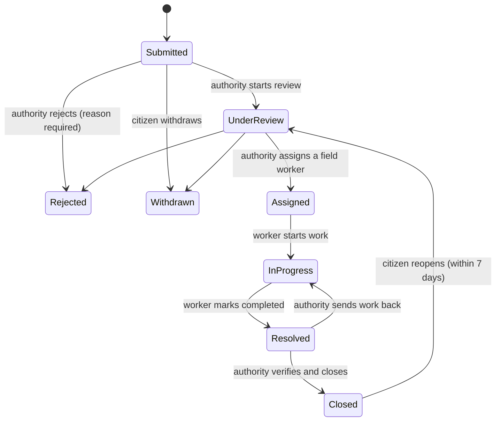

# CivicTrack - Civic Issue Reporting and Management System

**Live demo: https://civic-track-ekj7.onrender.com/**

Citizens report public problems (potholes, garbage, broken streetlights, water leakage, drainage issues ...),
municipal authorities review, prioritise and assign them, and field workers update the progress until the work is
verified and closed.

> **About the live demo:** it runs on a free hosting tier. After a period of inactivity the server goes to sleep,
> so the **first page can take about a minute to load**. Photos uploaded to the live demo are stored on the server's
> disk by default and can disappear when the server restarts (see *Photo storage*).
>
> This is a college demonstration project, not a production municipal service.

---

## Table of contents
1. [Features](#features)
2. [Complaint workflow](#complaint-workflow)
3. [Technology stack](#technology-stack)
4. [Architecture and project structure](#architecture-and-project-structure)
5. [Java OOP concepts used](#java-oop-concepts-used)
6. [Database](#database)
7. [Security](#security)
8. [Run it locally](#run-it-locally)
9. [Configuration (environment variables)](#configuration-environment-variables)
10. [Demo accounts](#demo-accounts)
11. [Testing](#testing)
12. [Deployment](#deployment)
13. [Optional features and limitations](#optional-features-and-limitations)
14. [Screenshots](#screenshots)
15. [More documents](#more-documents)

---

## Features

### Citizen
- Register and log in; change name and password from **My profile**
- Every complaint gets a short **reference number** (e.g. `CT-AB12-CD34`) shown after submitting
- Report a complaint: title, description, category, location text, **optional map pin** (click the map or use "my current location") and an optional JPEG/PNG photo
- **Duplicate warning** when a similar open complaint already exists nearby
- Track every complaint with a **status timeline**; paged list of own complaints
- **Comment** on a complaint (talk to the authority / worker), **withdraw** it before it is assigned, **reopen** it within 7 days of closing if it is not really fixed
- Leave **feedback** (1-5 stars) after resolution
- Notifications (bell icon) when the status changes or someone comments

### Municipal authority
- Dashboard with search, filters (status, category, date, **overdue only**), paging and **CSV export**
- Status chips with counts, plus charts (by status, by category)
- **Map of all complaints** coloured by status (red ring = overdue), with filters
- Worker workload is shown while assigning (least busy worker first)
- Start review, set priority, **assign / re-assign** a field worker, **reject with a reason**, verify and **close**, or send work back to the worker
- **Overdue marker**: a red badge when open work is older than the target for its priority (Urgent 1 day, High 3, Medium 7, Low 14)
- Notified when a complaint is reported, completed by a worker, reopened or withdrawn

### Field worker
- List and **map view** of assigned complaints (pins, popups, "get directions" link)
- Start work, add progress notes, mark work as completed for verification
- Notified when a complaint is assigned or sent back

### Administrator
- **System overview**: key numbers, recent complaints, charts and status breakdown
- **Users**: create staff accounts; one actions menu per user - **edit name, email and role**, view **activity timeline**, **reset password**, disable / enable, delete (only when the account has no history)
- **Categories**: add, edit, hide / show
- **Announcements**: publish notices (info / warning / urgent, optional end date) that appear at the top of the pages
- **Worker performance**: open jobs, overdue jobs, completed jobs, average time to complete and average citizen rating per worker (also open to authorities)
- **Audit log** of every status change, assignment, priority change and note, with **CSV export**
- **Per-user activity timeline**: logins, failed logins, lock-outs, password and account changes, and the complaints, status changes, comments and feedback made by that user (no passwords or IP addresses are stored)
- Read-only access to complaints (admins cannot comment or change work)

### For everyone
- **Public tracking**: anyone can look up a complaint by its reference number (status and dates only - nothing personal) at `/track`
- **Help & FAQ** page with the status meanings and privacy information
- **Dark mode** (sun / moon button) and an **installable app** (add to home screen; a friendly offline page)
- Responsive layout (tables turn into cards on phones), accessible forms, skip-to-content link, keyboard focus outlines
- Password fields with **show / hide** button, live **strength bar** and Caps Lock warning
- Friendly error pages, empty states, success / error messages, "please wait" state on buttons
- Account lock-out: 5 wrong passwords lock the account for 10 minutes

---

## Complaint workflow



The allowed moves are defined once, in `ComplaintStatus.allowedNext()`, and enforced by `Complaint.changeStatus()`
and the service layer. Every change is stored in `complaint_status_history` with the previous status, new status,
user, time and notes.

---

## Technology stack

| Area | Technology |
|------|------------|
| Language | Java 21 |
| Backend | Spring Boot 3.5 (Web, Validation, Data JPA, Security) |
| Frontend | Thymeleaf, HTML, CSS, Bootstrap 5, Bootstrap Icons |
| Maps and charts | Leaflet + OpenStreetMap (no API key), Chart.js |
| Database | PostgreSQL on Supabase; Hibernate / Spring Data JPA; Flyway migrations |
| Build and tests | Maven, JUnit 5, Mockito, Spring Boot Test, H2 (tests only) |
| Hosting | Docker image on Render (free tier) |

---

## Architecture and project structure

Layered design: **controller -> service (interface + implementation) -> repository -> entity**, with DTOs for form
validation. Controllers contain no business rules; services use constructor injection.

```
src/main/java/com/civictrack/
  config/       SecurityConfig, DataInitializer
  controller/   Home (public pages), Auth, Citizen, Complaint, Authority, Worker, Admin, Profile, Notification,
                WorkerPerformance (+ helpers)
  dto/          form objects with validation annotations
  entity/       BaseEntity, User, Category, Complaint, Assignment, StatusHistory, Feedback,
                ComplaintComment, Notification, ActivityLog, Announcement
  enums/        Role, ComplaintStatus, Priority, ActivityType, AnnouncementSeverity
  exception/    custom exceptions + GlobalExceptionHandler
  repository/   Spring Data interfaces + ComplaintSpecs (dynamic filters)
  security/     CustomUserDetails(+Service), LoginAttemptService + listener
  service/      interfaces: Complaint, User, Category, Feedback, Inbox, Activity, Announcement, WorkerStats,
                Notification, FileStorage
  service/impl/ implementations and helpers (CsvUtil, ImageFiles, LocationSimilarity)
  validation/   @StrongPassword
src/main/resources/
  db/migration/ V1 ... V5 (Flyway)
  templates/    Thymeleaf pages and fragments
  static/       css/app.css, manifest.webmanifest, sw.js, offline.html, icons/
src/test/       unit, repository, security and page-rendering tests
docs/           ER diagram, deployment guide, report outline, demo checklist
```

---

## Java OOP concepts used

| Concept | Where | How |
|---------|-------|-----|
| **Encapsulation** | `Complaint`, `User` | Private fields; no `setStatus()`. `changeStatus()` validates every move; constructors validate their input. |
| **Abstraction** | `ComplaintService`, `UserService`, `NotificationService`, `FileStorageService` | Controllers depend on interfaces, not implementations. |
| **Inheritance** | `BaseEntity` (`@MappedSuperclass`) | Shared id and created / updated timestamps for all entities. The only inheritance used. |
| **Polymorphism** | `NotificationService` -> `InAppNotificationService`, `LogNotificationService`, `EmailNotificationService`; `FileStorageService` -> `LocalFileStorageService`, `SupabaseFileStorageService` | `ComplaintServiceImpl` receives *all* notification implementations and calls each one the same way. Storage is chosen by configuration. |
| **Composition** | `ComplaintServiceImpl`, `UserServiceImpl` | Built from repositories and other services through constructor injection. |
| **Enums with behaviour** | `ComplaintStatus`, `Priority`, `Role`, `ActivityType` | The workflow rules live in the status enum; priority knows its target time. |
| **Exception handling** | `exception` package | `ResourceNotFoundException`, `ForbiddenOperationException`, `BusinessRuleException`, `InvalidStatusTransitionException`; one `GlobalExceptionHandler` shows friendly pages and never a stack trace. |
| **SOLID** | Layers and interfaces | Single responsibility per layer; dependency inversion through interfaces; adding a new notification channel needs no change to existing code. |

---

## Database

PostgreSQL schema managed by **Flyway** (Hibernate only *validates* that entities match the tables). UUID primary keys,
enums stored as strings, foreign keys, indexes and `CHECK` constraints. See [`docs/ER_DIAGRAM.md`](docs/ER_DIAGRAM.md).

| Table | Purpose |
|-------|---------|
| `users` | Accounts and roles |
| `complaint_categories` | Complaint types |
| `complaints` | The complaints (with optional latitude / longitude) |
| `assignments` | Which worker is assigned (one active assignment per complaint) |
| `complaint_status_history` | Append-only history / audit trail |
| `feedback` | Citizen rating after resolution |
| `complaint_comments` | Conversation on a complaint |
| `notifications` | In-app notifications |
| `activity_log` | Account events (logins, security, admin actions) |
| `announcements` | Notices shown at the top of the pages |

| Migration | Content |
|-----------|---------|
| V1 | Core schema |
| V2 | Seed categories |
| V3 | Notifications, `WITHDRAWN` status |
| V4 | Comments, map coordinates |
| V5 | Activity log |
| V6 | Complaint reference numbers, announcements |

Never edit a migration that has already run - add a new one.

---

## Security

- Passwords hashed with **BCrypt**; strength rules enforced on the server (8+ characters, a letter and a number)
- **Role-based access** enforced on the server in two layers: URL rules in `SecurityConfig` and role / ownership checks inside the services (e.g. a citizen can only see their own complaints, a worker only their assignments)
- **CSRF protection**, session-fixation protection, HTTP-only SameSite cookies (Secure in production)
- **Account lock-out** after repeated wrong passwords; failed logins and lock-outs are recorded
- Validated uploads (size limit, real file signature, random file names; photos are served only through an access-checked endpoint)
- CSV exports neutralise spreadsheet formulas; exports never contain passwords
- Secrets only in environment variables; error pages never show stack traces or internal details

---

## Run it locally

**Requirements:** JDK 21, Maven 3.9+ (IntelliJ includes Maven), Git, a free [Supabase](https://supabase.com) project.

1. Clone the repository and open it in IntelliJ IDEA.
2. Copy `.env.example` to `.env` (it is git-ignored) and fill in your Supabase details:
   ```
   DB_URL=jdbc:postgresql://<host>:5432/postgres?sslmode=require
   DB_USERNAME=<user>
   DB_PASSWORD=<password>
   ```
   Use the Supabase **Session pooler** connection details if the direct host does not work on your network.
   Avoid the Transaction pooler (port 6543).
3. Run `CivicTrackApplication` (or `mvn spring-boot:run`). Flyway creates the tables on first start.
4. Open http://localhost:8080.

The default profile is `dev`, which creates demo accounts so you can try every role immediately.
**Never enable demo accounts in production** (`civictrack.seed-demo-data=false`; the `prod` profile already does this).

---

## Configuration (environment variables)

| Variable | Required | Purpose |
|----------|----------|---------|
| `DB_URL`, `DB_USERNAME`, `DB_PASSWORD` | Yes | PostgreSQL connection |
| `SPRING_PROFILES_ACTIVE` | Production | `prod` (the Docker image sets it) |
| `ADMIN_EMAIL`, `ADMIN_PASSWORD` | Production | Creates the first administrator if none exists with that email |
| `PORT` | Set by host | HTTP port (default 8080) |
| `STORAGE_MODE` | No | `local` (default) or `supabase` for permanent photo storage |
| `SUPABASE_URL`, `SUPABASE_KEY`, `SUPABASE_BUCKET` | Only for `supabase` storage | Private storage bucket and server key (never commit the key) |
| `UPLOAD_DIR` | No | Folder for local photo storage |
| `NOTIFICATION_MODE` | No | `log` (default) or `email` (needs SMTP settings) |

Never commit `.env` or any credential.

---

## Demo accounts

Create your own short demo accounts from **Admin -> Users** (and register a citizen on the Register page), then list
them here for the viva:

| Role | Email | Password |
|------|-------|----------|
| Administrator | *(your admin email)* | *(your password)* |
| Municipal authority | *(add)* | *(add)* |
| Field worker | *(add)* | *(add)* |
| Citizen | *(add)* | *(add)* |

If the repository or this README is public, **do not publish real passwords** - share them separately.

---

## Testing

```
mvn test            # command line
```
IntelliJ: right-click `src/test/java` -> *Run 'All Tests'*. Tests use an in-memory H2 database (profile `test`), so no
Supabase connection is needed.

| Test class | Covers |
|------------|--------|
| `ComplaintStatusTest`, `ComplaintTest` | Valid / invalid status transitions, entity rules, overdue logic, map coordinates |
| `ComplaintServiceImplTest` | Assignment, permissions, comments, withdraw, reopen, notifications |
| `UserServiceImplTest` | Registration, hashing, admin edit / reset / delete rules, CSV export |
| `CategoryServiceImplTest`, `InboxServiceImplTest`, `ActivityServiceImplTest` | Category editing, notification ownership, activity timeline |
| `LoginAttemptServiceTest` | Lock-out rules |
| `LocationSimilarityTest`, `CsvUtilTest`, `ImageFilesTest`, `ChartDataHelperTest`, `ReferenceNumbersTest` | Helper logic |
| `AnnouncementServiceImplTest`, `WorkerStatsServiceImplTest` | Announcements, worker performance maths |
| `ComplaintRepositoryTest` | JPA mappings, filters, search, overdue filter |
| `SecurityAccessTest` | Protected routes by role, CSRF, registration, login, lock-out, page rendering |
| `CivicTrackApplicationTests` | Application context starts |

---

## Deployment

Deployed as a Docker container on **Render (free tier)**, with the database on **Supabase**:

1. Push the repository to GitHub.
2. Render -> New -> Web Service -> select the repository -> runtime **Docker**, instance type **Free**.
3. Add the environment variables from the table above (`DB_*`, `ADMIN_*`).
4. Every push to `main` redeploys automatically; Flyway applies new migrations on start-up.

Full guide, checklist and troubleshooting: [`docs/DEPLOYMENT.md`](docs/DEPLOYMENT.md).
Free tiers can change or sleep and are never guaranteed - keep a local copy ready for demonstrations.

---

## Optional features and limitations

| Feature | Status |
|---------|--------|
| Map pins, comments, charts, CSV export, overdue marker, reopen, audit log, activity timeline | Included |
| Reference numbers + public tracking, authority map, announcements, worker performance, dark mode, installable app (PWA), Help / FAQ | Included |
| Permanent photo storage in Supabase Storage | Implemented, **off by default** (needs a private bucket and server key) |
| E-mail notifications | Implemented, **off by default** (needs an SMTP account) |
| Forgot-password by e-mail | Not included - an administrator resets passwords |
| Live push notifications | Not included - the bell updates when a page loads |

**Known limitations**
- Login lock-out counters are kept in memory (they reset when the server restarts).
- Photos on the free host are lost on restart unless Supabase storage is enabled.
- Maps use OpenStreetMap tiles (light use) and charts / icons load from a CDN, so they need internet access.
- Changing a user's role or email takes effect the next time they log in.
- The public tracking page is protected only by the randomness of the reference number (about 40 bits); it shows no personal data.
- The installable app caches only an offline page, never complaint data. Charts and dark-mode colours update on the next page load.

---

## Screenshots

Add your screenshots to `docs/screenshots/` and link them here:

| Page | Screenshot |
|------|------------|
| Landing page | `docs/screenshots/landing.png` |
| Citizen: report form with map | `docs/screenshots/report.png` |
| Complaint timeline and comments | `docs/screenshots/detail.png` |
| Authority dashboard | `docs/screenshots/authority.png` |
| Worker map | `docs/screenshots/worker-map.png` |
| Admin overview and charts | `docs/screenshots/admin.png` |
| Users and activity timeline | `docs/screenshots/users.png` |
| Passing tests | `docs/screenshots/tests.png` |

---

## More documents
- [`docs/ER_DIAGRAM.md`](docs/ER_DIAGRAM.md) - database diagram
- [`docs/DEPLOYMENT.md`](docs/DEPLOYMENT.md) - deployment guide and checklist
- [`docs/REPORT_OUTLINE.md`](docs/REPORT_OUTLINE.md) - college report outline
- [`docs/DEMO_CHECKLIST.md`](docs/DEMO_CHECKLIST.md) - demo script and checklist
