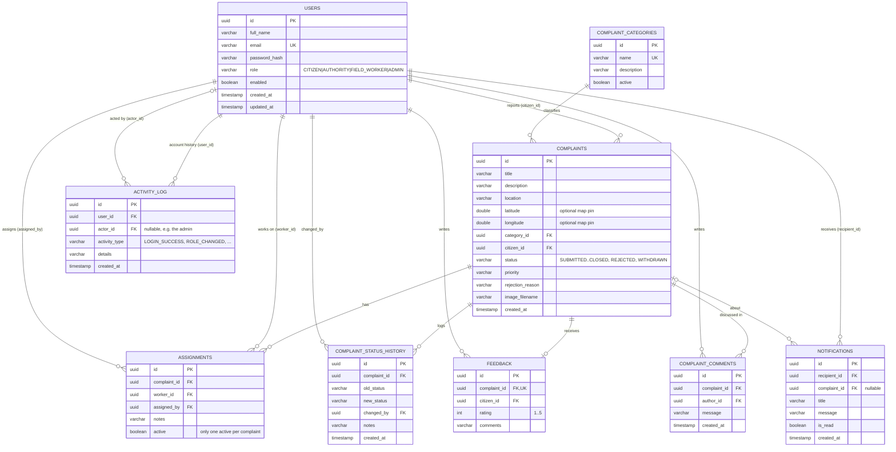

# Database design

Design notes
- UUID primary keys everywhere (generated by Hibernate). Enums stored as strings, guarded by `CHECK` constraints where the set is fixed.
- A partial unique index (`ux_assignments_one_active`) guarantees one active assignment per complaint; re-assignment deactivates the old row.
- `complaint_status_history` is append-only and doubles as the complaint audit log (status changes, assignments, priority changes, worker notes).
- `activity_log` records account events (logins, failed logins, lock-outs, password changes, admin actions). It never stores passwords or IP addresses.
- A user's full activity timeline is built by combining `activity_log` with their complaints, status changes, comments and feedback.
- Photos are stored on disk or in a private Supabase Storage bucket; only the generated file name is stored in the database.
- Migrations: V1 schema, V2 categories, V3 notifications + WITHDRAWN, V4 comments + coordinates, V5 activity log.
