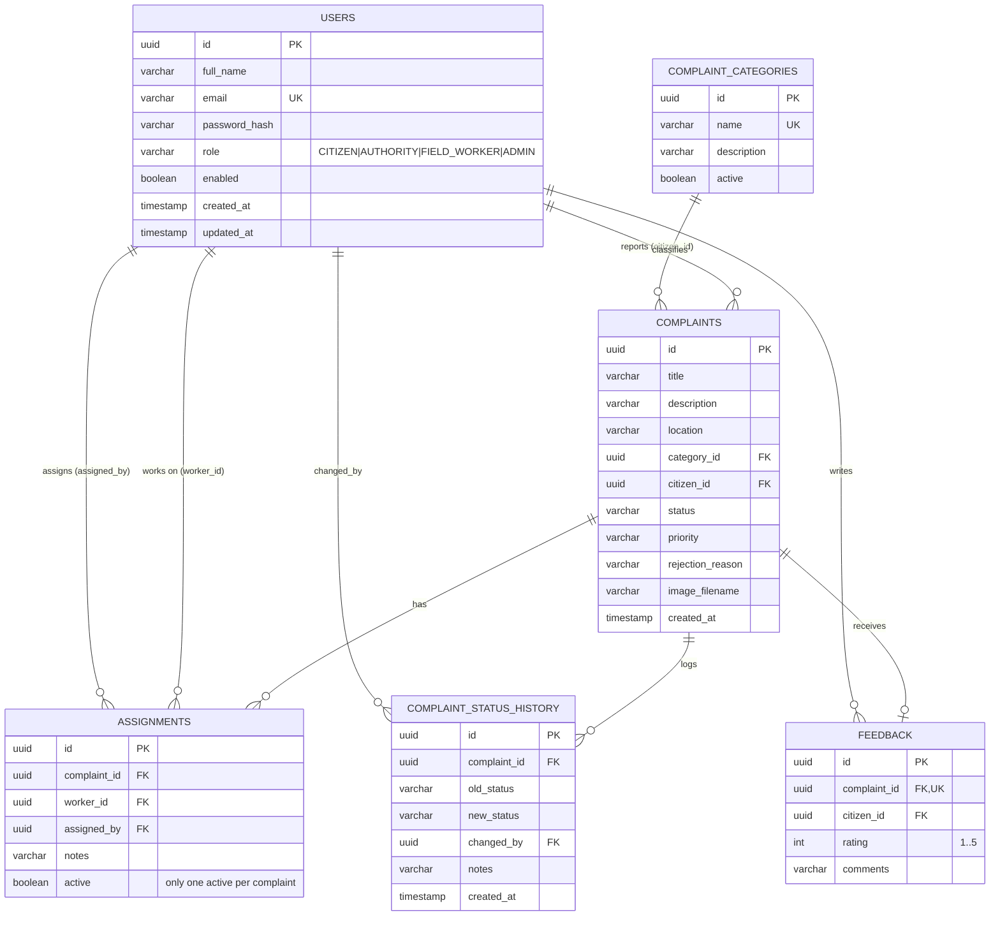

# Database design

Design notes
- UUID primary keys everywhere (generated by Hibernate). Enums stored as strings guarded by `CHECK` constraints.
- A partial unique index (`ux_assignments_one_active`) guarantees one active assignment per complaint; re-assignment deactivates the old row.
- History rows are append-only. Image files are stored on disk; only the generated file name is stored in the database.
